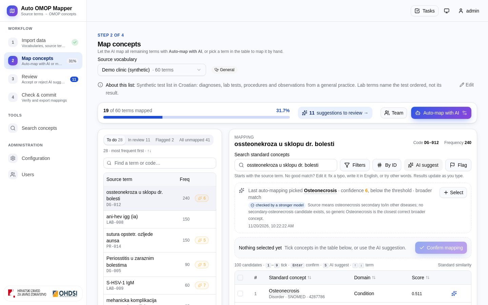
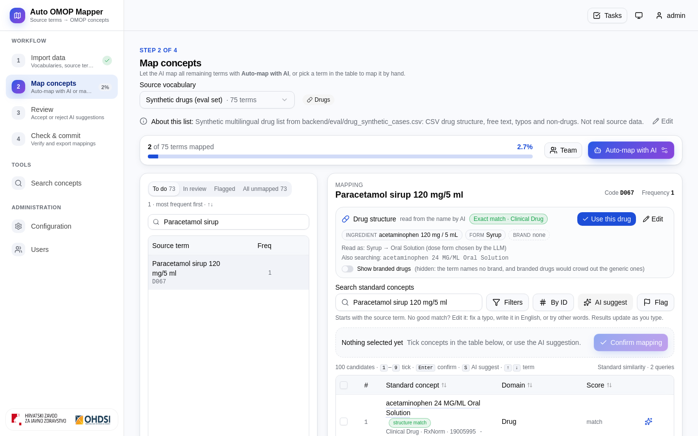
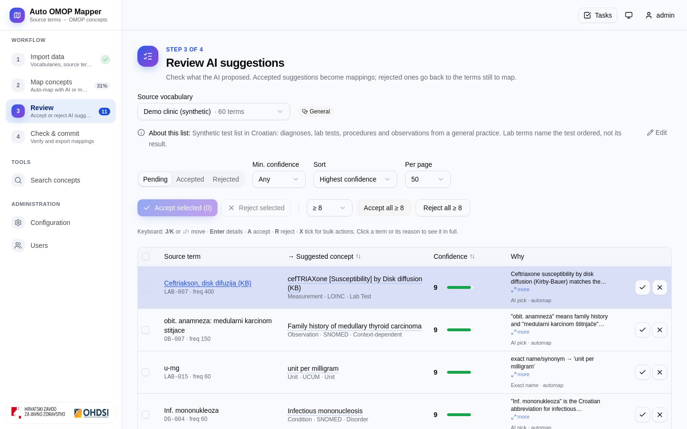
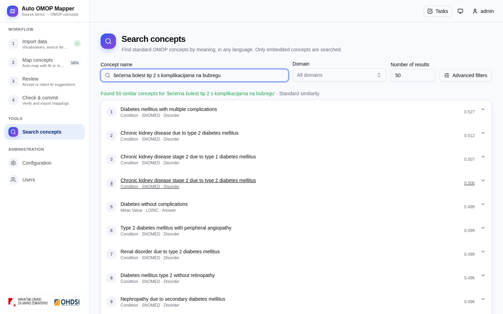
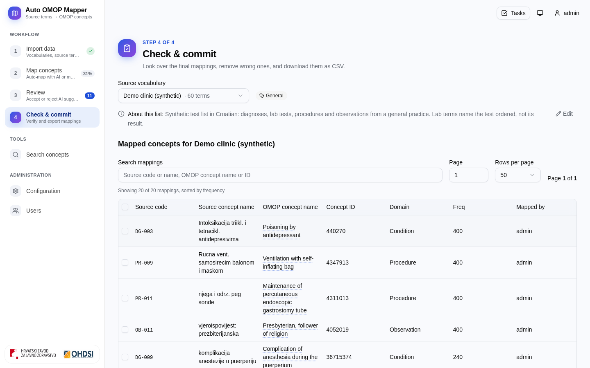
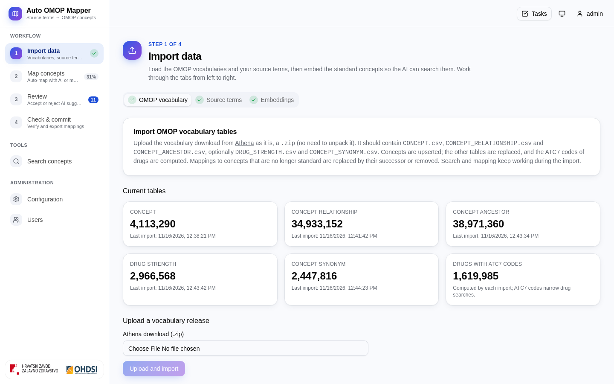

# Auto OMOP Mapper 🗺️

Maps source medical terms (in any language) to OMOP standard concepts. It combines vector search with LLM reranking and, for drugs, a deterministic match on the drug's structure. Every automatic result can go through a review queue, so a person decides what is committed.

[2025 OHDSI Europe Symposium: abstract](https://drive.google.com/file/d/1m-jeBvWbRCNxFuffR210nhSAK-BNqUWF/view?usp=drive_link) · [poster](https://drive.google.com/file/d/19kEdJ-7Z5XAA33nVR58EvH2oJnZD5ZNY/view?usp=drive_link)

The full reference (deployment, every setting, providers and costs, drug mapping, pipelines, development) is in [docs/reference.md](docs/reference.md).



<details>
<summary>More screenshots</summary>

**Drug mapping:** the structure read from the name and its exact RxNorm match.


**Review:** AI suggestions with confidence and reason.


**Search:** semantic search in any language.


**Verify & publish:** final mappings, ready to publish as a release and export.


**Import:** OMOP vocabulary tables, source terms and embeddings.


</details>

All data shown is synthetic.

## Quick start

You need Docker with Compose v2, an OMOP vocabulary download from [Athena](https://athena.ohdsi.org/) and an API key for an LLM provider.

```bash
cp .env.example .env                  # set POSTGRES_PASSWORD, JWT_SECRET (openssl rand -hex 32),
                                      # ADMIN_PASSWORD, LITELLM_MASTER_KEY
cp .env.litellm.example .env.litellm  # provider keys (default models: ANTHROPIC_API_KEY, OPENAI_API_KEY)
docker compose up -d --build
```

Before starting, put the TLS certificate and key in `certs/` as `fullchain.pem` and `privkey.pem` (see [Production deployment](docs/reference.md#production-deployment)). The UI is served over HTTPS on port 443 (port 80 redirects); sign in as `ADMIN_USERNAME` / `ADMIN_PASSWORD`.

## User guide

1. **Import → OMOP Vocabulary Tables** (admin). Upload the Athena zip as it is. `DRUG_STRENGTH.csv` enables deterministic drug matching.
2. **Import → Embedding Management** (admin). Embed the standard concepts, filtered by domain if you want. This is needed once per vocabulary release; later imports re-embed only what changed.
3. **Import → Source Concepts**. Upload a CSV with `source_value` and `source_concept_name`. Optional columns:
   - `freq`;
   - `concept_id` for existing mappings (`;`-separated);
   - `source_description`: what the term means or when to use it (up to 2,000 characters). It is shown with the term and given to the AI steps;
   - drug columns in the shape of OMOP `drug_strength`.

   ```csv
   source_value,source_concept_name,ingredient,amount_value,amount_unit,dose_form
   N02BE01-1,Paracetamol 500 mg tbl,paracetamol,500,mg,tablet
   ```

4. **Map Concepts**. Work through the unmapped terms. Search, select one or more concepts, say how they relate to the term (exact by default; broader, narrower or related) and confirm.
   - **AI suggest** runs the mapping pipeline for one term and shows its pick, confidence and trace.
   - **Auto map** runs the pipeline for the whole vocabulary in the background. In *review* mode (the default) its picks become suggestions. Its settings choose target domains and, optionally, target vocabularies (e.g. LOINC), as *only these*, *preferred* or not used.
   - For drugs, the panel shows the structure (ingredients, strengths, dose form, brand, quantity) and its exact match. You can edit the structure and match again. Branded drugs are hidden unless the term names a brand.
5. **Review**. Accept or reject suggestions one by one, as a selection, or all above a confidence level.
6. **Check & Commit**. See and undo mappings with their match type, view statistics and download `vocabulary_<id>_mappings.csv`. Every user can review the mapped set here and flag a mapping with a question (**Mappings with a question** lists them); the release panel warns about open questions before publishing.
   - **Publish release** (admin) makes the current mappings the official version and locks the vocabulary: no mapping, unmapping, auto-mapping or accepting suggestions until an admin clicks **Start release N+1**.
   - Each release has its OMOP `source_to_concept_map`. Mappings of an earlier release that were later changed or removed stay in it, with a `valid_end_date` of the day before the release that changed them and `invalid_reason` `U` (remapped) or `D` (removed).
   - **Tools → Export mappings** puts the published releases of several vocabularies in one `source_to_concept_map`, each with its own `source_vocabulary_id`.
   - An OMOP vocabulary update that has to replace or remove mappings of a released vocabulary starts its next release automatically, with a note.
7. **Search**. Semantic search with domain, vocabulary and ATC7 filters.
8. **Configuration** (admin). LLM and embedding models, mapping pipelines, and **Users**.

**Accounts.** Admins create users, or people register on the sign-in page with an email and password. A self-registered account can sign in only after an admin approves it under **Users → Waiting for approval**. Users map, review and check the mapped set; admins also publish releases, import vocabularies, manage embeddings, change settings and manage users.

## How mapping works

Each term goes through a pipeline of steps, and it stops as soon as one step is confident:

1. **Deterministic matches**: a previously reviewed mapping of the same name, the source code in a known code system, or an exact concept name or synonym.
2. **Drugs**: the structure comes from the CSV, or the LLM reads it from the name. It is matched exactly on `drug_strength` (RxNorm and RxNorm Extension) at the level of detail the source has.
3. **Translation** into English OMOP wording, then **vector search** (up to 30 candidates).
4. **LLM rerank** picks a candidate with a confidence score. Unsure picks go to a stronger model.
5. Terms that are still unsure get **rewritten searches**, then a **tool-using agent**, then a **final decision** by the stronger model. These picks always go to review.

## Technical details

| Service | Role |
|---|---|
| `frontend` | React + TypeScript (Vite, Tailwind, shadcn/ui, TanStack Query), served by nginx |
| `backend` | FastAPI REST API with JWT cookie auth; Alembic migrations run on start-up |
| `worker` | Celery: imports, embeddings, auto-mapping |
| `postgres-db` | PostgreSQL 18 with pgvector and pgvectorscale (StreamingDiskANN index) |
| `redis` | Celery broker, caches, task locks |
| `litellm` | Proxy to every LLM and embedding provider; the only service that holds provider keys |

- **Default models:** `anthropic/claude-sonnet-5-5` (rerank, translation, agent), `anthropic/claude-opus-5-5` (escalation) and `openai/text-embedding-3-large` (1536 dims). Any LiteLLM provider works, including local Ollama.
- **Pipelines:** declarative LangGraph pipelines in YAML ([`backend/app/workflows/definitions`](backend/app/workflows/definitions)). Instructor runs the structured LLM calls and Pydantic AI runs the agent. Plugins can add new steps ([example](examples/workflow_plugins/translate_query)).
- **Settings:** environment variables, all documented in [`.env.example`](.env.example).
- **Development:** run `docker compose -f docker-compose.dev.yaml up -d --build`. The frontend runs on <http://localhost:5173> and the API docs on <http://localhost:8000/api/docs>. Backend tests: `docker compose -f docker-compose.dev.yaml exec backend pytest`. Frontend checks and CI are described in the [reference](docs/reference.md#development).

## Affiliation

Developed at the Croatian Institute of Public Health (HZJZ). The HZJZ and OHDSI logos in `frontend/public/logos/` belong to those organisations.
